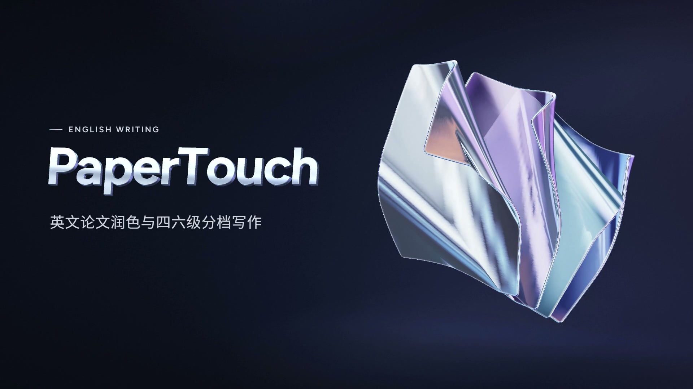

# PaperTouch

PaperTouch 帮你润色已有英文论文，也能按大学英语四级、六级的不同档位写作文。输入 `$paper-touch-en` 后选择文章类型；如果已经写明题目、考试和档位，就可以直接开始。

**[下载 v1.3.0 安装包](https://github.com/ZXON-ZTX/PaperTouch/releases/download/v1.3.0/paper-touch-en.zip)** · [更新说明](https://github.com/ZXON-ZTX/PaperTouch/releases/tag/v1.3.0) · [35 秒宣传片（MP4）](https://github.com/ZXON-ZTX/PaperTouch/releases/download/v1.3.0/PaperTouch-3D.mp4)

[](https://github.com/ZXON-ZTX/PaperTouch/releases/download/v1.3.0/PaperTouch-3D.mp4)

## v1.3.0 有什么新功能

| 文章类型 | 可选方式 | 实际用途 |
| --- | --- | --- |
| ① 英文论文 | 白名单轻修（默认）、专家润色，也可仅审核 | 轻修只处理六条规则命中的文字。专家模式可参考作者提供的图注、术语定义和相邻段落，改善指定段落的表达与衔接。 |
| ② 英语四级作文 | 及格档、高分档 | 及格档用常见词和具体事例讲清理由。高分档可用对比或条件进一步展开理由。 |
| ③ 英语六级作文 | 及格档、高分档 | 及格档解释例子如何支持观点。高分档进一步说明观点何时成立，也可回应反方理由。 |

选了四级或六级但还缺档位、题目时，PaperTouch 会一起询问缺少的信息，同一篇作文可以接着写。档位用于定位练习难度。各档对同一题目的处理方式见[四档写作指南](paper-touch-en/references/cet-essays.md)。

## 安装

1. 下载 [paper-touch-en.zip](https://github.com/ZXON-ZTX/PaperTouch/releases/download/v1.3.0/paper-touch-en.zip) 并解压。
2. 将整个 `paper-touch-en` 文件夹放进助手的技能目录。以 Windows 上的 Codex 为例，安装后的入口是 `%USERPROFILE%\.agents\skills\paper-touch-en\SKILL.md`。
3. 在 Codex 中输入 `$paper-touch-en`。如果菜单尚未出现，重新打开 Codex 后再试。

## 试一试

```text
$paper-touch-en 四级高分档。以校园志愿服务为题写 130–160 词，只给英文正文。
```

```text
$paper-touch-en 六级作文，及格档和高分档各写一篇。题目是“大学生应如何使用学习软件？”
两篇都写 160–180 词，再用中文解释论证的区别。
```

```text
$paper-touch-en 使用论文专家模式。请参考下方方法段的指标定义，只润色摘要。
保留数字、引用和结论强度，只输出改后的摘要。
[粘贴英文摘要和方法段]
```

若摘要与结果对同一个 **14 ms** 分别使用 *median* 和 *mean*，可以要求专家模式“仅审核”。PaperTouch 会定位这两处表述，说明差异，并请作者核实计算口径。[科研上下文润色指南](paper-touch-en/references/expert-editing.md#using-the-authors-research-context)

## 论文轻修和专家润色

默认轻修遵循 E1–E6，保留未命中部分的原文和结构。例如 `We conducted an evaluation of the encoder.` 可以轻修为 `We evaluated the encoder.`。六条规则的适用条件和例外见[白名单](paper-touch-en/references/english-rules.md)。

明确指定专家模式后，可在授权的英文段落内调整语法、措辞和局部衔接。编辑时保留数字、单位、公式、引用与原主张的关系，以及实验条件、研究状态和不确定性。模式内置计算机与网络安全指导，以及机械与控制、通信、生物医学、化学与材料、物理、工程模型等领域的案例参考。查阅[分领域指南](paper-touch-en/references/crossfield-expert.md)和 [Stop Slop 学术适配](paper-touch-en/references/stop-slop-academic.md)。

## 学习资料与验证

- [计算机与安全研究资料 ZIP](https://github.com/ZXON-ZTX/PaperTouch/releases/download/v1.3.0/PaperTouch-style-study.zip) 记录了 100 篇开放获取论文的样本来源、选段阅读和留出检查。详见[语料与阅读范围](paper-touch-en/references/style-evidence.md)。
- [跨学科研究资料 ZIP](https://github.com/ZXON-ZTX/PaperTouch/releases/download/v1.3.0/PaperTouch-crossfield-study.zip) 记录了 142 条选文线索、实际取得的材料和查阅位置。详见[来源记录](paper-touch-en/references/crossfield-sources.json)。两份资料均可按需单独下载。
- 技能包附带 19 项自动测试，覆盖六条白名单和补丁保护。进入 `paper-touch-en` 目录后可运行 `python -B -m unittest discover -s tests`。论文专家模式的行为检查另见[验证记录](paper-touch-en/验证记录.md)。

补丁工具适用于 UTF-8 文本、Markdown 和 LaTeX 的白名单修改。工具会核对锚点、数字和受保护片段，将结果写入新文件。[补丁格式与限制](paper-touch-en/references/patch-format.md) · [完整使用说明](paper-touch-en/使用说明.md)

## 来源与许可

PaperTouch 的白名单方法源自 `lieflat-less-ai-tone`（Copyright © 2026 shiujan）。四、六级练习档位参考了 [Talorcat 的 English Writing Coach](https://github.com/Talorcat/English-writing-master)，PaperTouch 的四档指南与示例为本项目编写。论文编辑中采用的 Stop That Shit 和 Stop Slop 原则及许可均列在[来源说明](paper-touch-en/references/source-notes.md)。[MIT 许可证](LICENSE)
